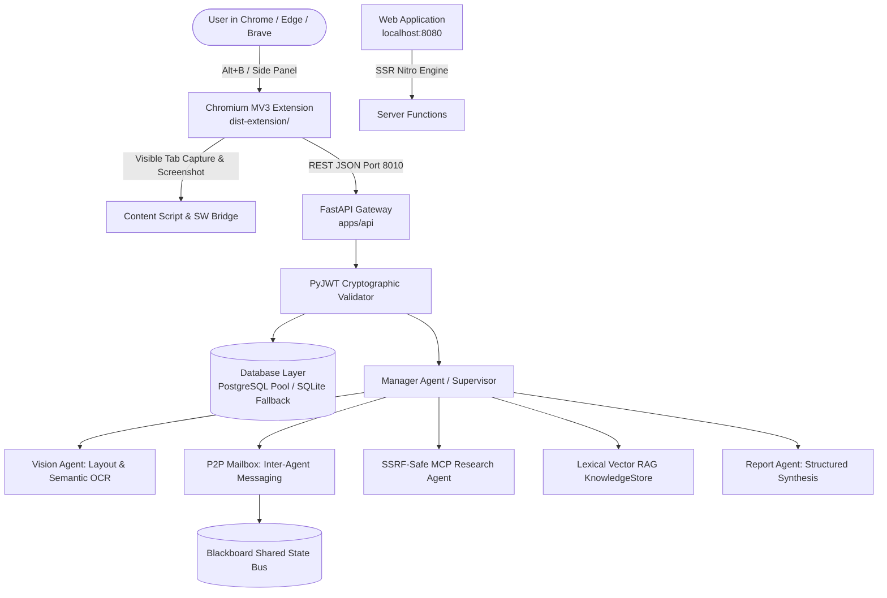

# MindSpace Stage 8 — 5-to-10 Minute Academic Demonstration & Viva Guide

> **Project Identity:** Autonomous Multi-Agent AI Browser Assistant  
> **Platform:** Chromium Manifest V3 Side Panel + TanStack Start / React 19 UI + Python 3.12 FastAPI Multi-Agent Systems (MAS)  
> **Execution Mode:** 100% Zero-External-Dependency Offline First (Local Intelligence)

---

## 1. System Architecture & High-Level Topology



---

## 2. Five-to-Ten Minute Live Viva Demonstration Script

### Minute 0–2: System Startup & Zero-Cloud Verification
1. Open PowerShell and run the one-command setup verification:
   ```powershell
   .\start-demo.ps1
   ```
2. Explain the platform truth:
   - MindSpace runs completely offline without paid API credentials or external cloud databases.
   - Database defaults to local thread-safe SQLite with composite multi-tenant indexes, with seamless support for containerized PostgreSQL via `docker-compose.yml`.
   - Security controls: PyJWT cryptographic validation with clock skew tolerance, compound tenant isolation `(tenant_id, user_id)`, and physical socket-level SSRF defense.

### Minute 2–4: Extension Installation & Context Ingestion
1. Open Google Chrome $\to$ Navigate to `chrome://extensions`.
2. Toggle **Developer mode** $\to$ Click **Load unpacked** $\to$ Select:
   `mindspace-stage8/dist-extension`
3. Pin the **MindSpace** icon to the toolbar.
4. Navigate to any technical article or paper (e.g. `https://arxiv.org/abs/1706.03762`).
5. Press `Alt+B` or click the toolbar icon.
6. Observe:
   - Side panel mounts the TanStack Start / React 19 interface.
   - Active tab URL, title, clean DOM text, and viewport screenshot are extracted.
   - Point out the proactive restricted-page handling: attempting capture on `chrome://` or Web Store returns clean user guidance rather than crashing.

### Minute 4–6: Multi-Agent Lifecycle & P2P Coordination
1. In the terminal, execute the 8-step live walkthrough:
   ```powershell
   npm run demo
   ```
2. Walk through the 8 execution stages displayed on screen:
   - **Step 1 (Ingress)**: Ingests user query.
   - **Step 2 (Manager)**: Decomposes goal into multi-step execution plan.
   - **Step 3 (Selection)**: Appoints specialist agents (`browser_context_agent`, `rag_knowledge_agent`, `research_agent`, `report_agent`).
   - **Step 4 (P2P Mailbox)**: Dispatches addressed message to Research Agent via SQLite/Postgres mailbox.
   - **Step 5 (MCP Tool)**: Runs `extract_facts` tool with socket-level IP filter active.
   - **Step 6 (RAG Retrieval)**: Queries `KnowledgeStore` with deterministic `hash-bow-v1` lexical embeddings.
   - **Step 7 (Report Agent)**: Generates citation-grounded intelligence brief with explicit `[SIMULATED]` offline provenance tags.
   - **Step 8 (Audit Logging)**: Commits end-to-end execution trace into Blackboard audit log.

### Minute 6–8: Document Intelligence & RAG Inspection
1. Show the sample research papers located in `sample_documents/`:
   - `attention_transformer_research.txt`
   - `multi_agent_blackboard_systems.txt`
   - `browser_assistant_security_controls.txt`
2. Demonstrate how `pdfjs-dist` parses multi-page documents client-side in `src/components/mindspace/knowledge-base.tsx`.
3. Demonstrate RAG citation attribution: queries return exact document chunks with similarity scores.

### Minute 8–10: Observability, Diagnostics & Data Erasure
1. Inspect the operational diagnostics endpoint:
   ```powershell
   curl http://127.0.0.1:8010/v1/diagnostics
   ```
   Highlight:
   - Process uptime, PID, and engine health (`{"status": "healthy", "connected": true}`).
   - Active applied migrations: `001_core_schema`.
   - Provider availability: `offline-heuristic-rag`.
2. Demonstrate GDPR Right to Erasure / Data Purge:
   - Execute `DELETE /v1/user/data` to show complete cascading deletion across contexts, audit logs, and P2P messages.
3. Conclude with the test suite execution:
   ```powershell
   .\test-all.ps1
   ```
   Show that all 300+ automated tests across backend and frontend pass with a **100% success rate**.

---

## 3. Technology Justification & Overlap Analysis

| Technology | Role in MindSpace | Why Selected? | Alternatives & Trade-offs |
|---|---|---|---|
| **Chrome Manifest V3** | Browser Side Panel | Direct access to active tab DOM, viewport capture, and persistent side panel without breaking Chromium security policies. | Content-script-only: lacks UI space; DevTools panel: too developer-specific. |
| **FastAPI (Python 3.12)** | Agent API & Gateway | High-throughput async routing, native Pydantic v2 data contracts, ASGI middleware. | Flask (synchronous, slower); Node.js (harder to integrate Python AI/MAS libraries). |
| **TanStack Start & React 19** | Full-Stack Web Interface | Type-safe SSR, unified server functions (`createServerFn`), modern component reactivity. | Next.js (heavier, opinionated); Plain React SPA (no SSR, poorer SEO/previews). |
| **Blackboard Pattern** | Shared Multi-Agent State | Loose coupling: agents communicate results through append-only state bus rather than pairwise interdependencies. | Pure message bus: lacks central snapshot; Shared memory: non-persistent across worker restarts. |
| **P2P Mailbox** | Direct Agent Collaboration | Addressed, sequence-tracked, TTL-enforced inter-agent delivery for correlated task dispatches. | Polling: wasteful; Direct RPC: blocks agent threads during long runs. |
| **Model Context Protocol (MCP)** | Standardized Tool Interface | Vendor-neutral protocol for research tools (`web_search`, `extract_facts`) with socket-level SSRF interceptor. | Hardcoded Python functions: breaks agent modularity and external tool interoperability. |
| **A2A Protocol** | Agent-to-Agent SDK | Official Google `a2a-sdk` for JSON-RPC agent discovery and task delegation. | REST shortcuts: non-standardized metadata envelopes. |
| **Lexical Vector RAG** | Offline Knowledge Search | Deterministic hashed bag-of-words (`hash-bow-v1`) with cosine similarity and token overlap, requiring zero cloud embedding APIs. | Cloud embeddings (OpenAI/Voyage): breaks zero-external-dependency requirement. |

---

## 4. Key Limitations & Future Work

1. **Local Neural Embeddings**: Currently utilizes deterministic `hash-bow-v1` lexical vector hashing for offline mode. Future iterations can integrate local ONNX/GGUF models (e.g. `bge-small-en-v1.5`) via in-process WebAssembly/FastAPI.
2. **Google Cloud Live OAuth**: Requires operator registration of a Web Application Client in Google Cloud Console for live Gmail/Drive sync. The system fails closed safely via `GoogleNotConnectedError` when disconnected.
3. **Distributed Worker Clustered Limiter**: In-memory `SlidingWindowRateLimiter` handles single-server deployments; distributed multi-container deployments can bind to Redis via `REDIS_URL`.
